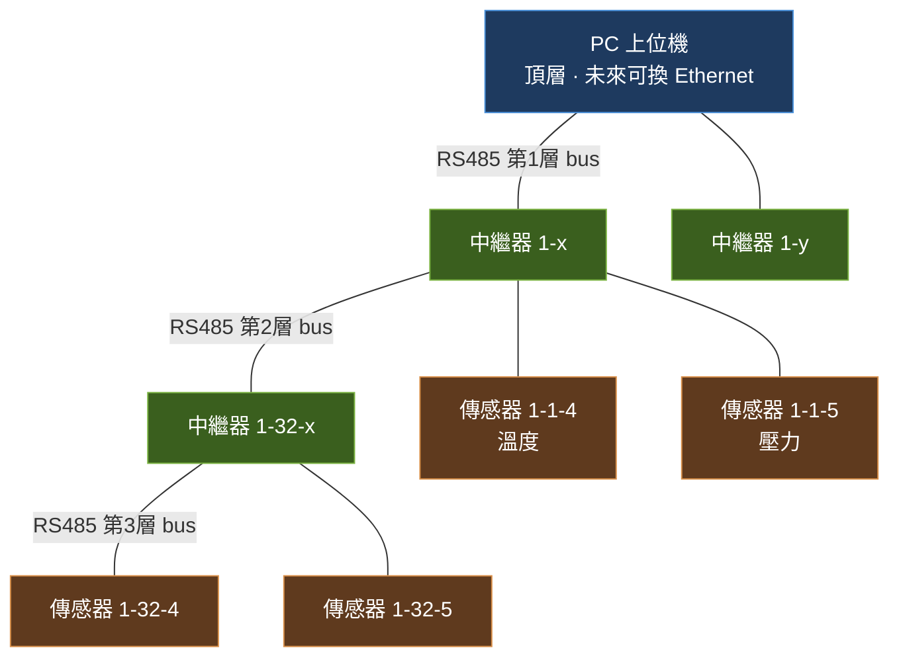
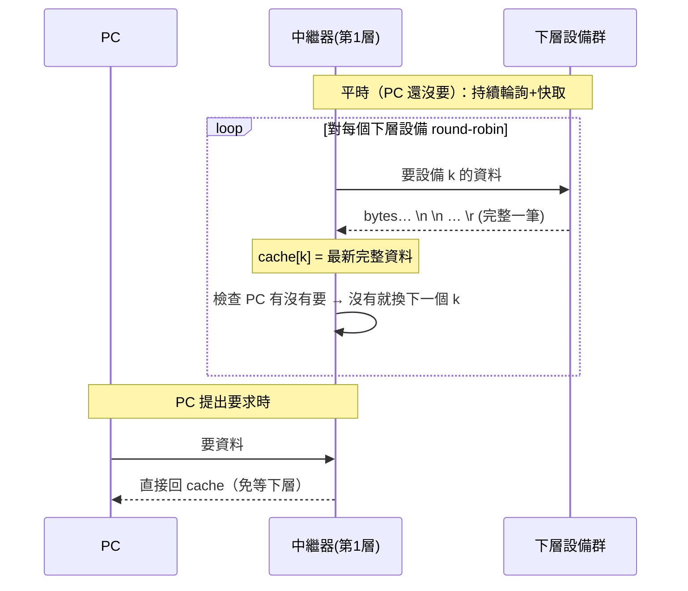

# 01 · 系統架構

## 0. 彈性定架：三段式（頭 / 核心 / 尾）

> 總原則（[06 §O](06_設計決策與待確認.md)）：系統要**好用、通用**。**頭段（PC 側）與尾段（外設側）盡量兼容通用、可插拔**，內部輕易換模組而不換整組＝彈性。**核心 RS485 不動**（可靠、抗噪、長距）。

```
[PC] ──頭段 adapter── [RS485 私有核心樹] ──尾段 adapter── [外部外設]
      可插拔傳輸          不變               可插拔協定
      有線 RS485/乙太      私有格式+自動終端+自動定址   MODBUS 只是其一
      無線 WiFi(非陸製)                          (包括但不限於)
```

- **核心**：RS485 + 私有格式 + 自動終端 + 自動定址（本文 + [02](02_通訊協定.md) + [10](10_自動終端與拓樸.md)）。
- **頭段**：PC 側可插拔傳輸——有線 RS485/乙太(W5500)、無線 WiFi（非陸製模組）。換傳輸不動核心。
- **尾段**：外設側可插拔協定——**MODBUS 為預設 driver，但不是唯一**；通用末端 + 可換擴充模組。
- **JSON 設備描述（DESC）保留為核心**：自動定址給「位置」，**JSON descriptor + 型錄給「身分與外設抓法」**（見 [02 §3.2](02_通訊協定.md)、[08 §6](08_末端外設_Driver_韌性架構.md)）。

## 1. 拓樸：RS485 bus 的樹狀堆疊

整個系統是**多段 RS485 bus 疊成的樹**。每一「層」其實是一條獨立的 RS485 multidrop bus；一台中繼器把「上一層的一條 bus」和「自己下一層的一條 bus」橋接起來。



- 一條 bus（一層裡的一個 master 底下）**最多 63 台**設備（自動定址鏈序 1–63，0 保留，見 [03](03_定址與指撥開關.md)）。
- 一台中繼器底下掛的，可以是**更下層的中繼器**、也可以是**末端傳感器**，混掛沒問題。
- 樹可以繼續往下長；層數靠字串位址表達，不會有「陣列開多大」的上限問題。

## 2. 兩種角色

| 角色 | 硬體/語言 | 對上層 | 對下層 |
|------|-----------|--------|--------|
| **末端傳感器模組（葉節點）** | C++ / STM32（F411…H7） | 是 slave：被輪詢才回話，回自己的位址+量測值 | 無 |
| **中繼器（分支節點）** | MicroPython / RP2040 | 是 slave：被上層要求才把 cache 回上去 | 是 master：主動輪詢自己這條 bus 上的孩子 |
| **PC（根）** | Python | — | 是 master：對第 1 層中繼器要資料 |

> 平台定案見 [08 §3](08_末端外設_Driver_韌性架構.md)、[09](09_軟體架構定案.md)：末端=STM32、中繼器=RP2040（去陸製排除 ESP32）。

> 關鍵心智模型：**中繼器 = 上層看它是「一個 slave」，下層看它是「一個 master」**。它兩個 UART：一個接上層 bus、一個接下層 bus（見 [02](02_通訊協定.md)）。

## 3. 資料流：下層一直跑、上層要才給（cache 樹）

因為是 RS485，**上層不主動推、只有下層被要求才回**。為了不讓 PC 的讀取速度拖垮整棵樹，每台中繼器**不等上層**，自己一直輪詢下層並把**最新一筆完整資料**暫存起來（cache）。上層一要，立刻把 cache 給出去。



- **cache 內容**：每台中繼器維護一個 `dict`，key = 下層設備的本地位址，value = 該設備最近一筆以 `\r` 收完的完整資料（含時間戳/新鮮度）。
- **新鮮度 / 逾時**：輪詢某設備若在等 `\r` 時逾時，就標記該筆為 stale 並跳過，換下一個（見 [02 §4](02_通訊協定.md)）。
- **越往下、cache 越即時**；越往上、彙整越多。PC 端拿到的是「一次要、就有一批現成資料」。

## 4. 位址如何被拼出來（逐跳前綴）

每台設備**只知道自己的本地位址**（自動定址給的鏈序，1–63）。完整路徑 `1-32-4` 是資料**往上流時逐跳拼出來**的：每經過一台中繼器，就把自己的本地位址前綴上去。

```
末端(本地=4)  回 "4 + 資料"
   ↑ 經過中繼器(本地=32)  → "32-4 + 資料"
      ↑ 經過中繼器(本地=1) → "1-32-4 + 資料"
         ↑ 到 PC：看到完整路徑 1-32-4
```

好處：新增層/設備不需要重配全域位址表；一台設備搬到不同分支，路徑自動跟著變（它自己不用知道全域位址）。詳見 [03 §3](03_定址與指撥開關.md)。

## 5. 傳輸層會是瓶頸的地方（未來擴充）

當層數與每層數量變多，**瓶頸在「PC 端接收速度受 RS485 限制」**，大量資料會排隊。預留擴充：

- **頭段可插拔**（PC ↔ 第 1 層）：有線 **Ethernet（RP2040 + W5500）** 或無線 **WiFi（非陸製模組，扛大量資訊）**，把「樹內用 RS485、對 PC 用網路」分開。ESP32 排除（去陸製）。
- 因此頂層中繼器要能同時當「下層 RS485 master」＋「對 PC 的網路節點」。這是 **模組 F 傳輸層抽象**（見 [09 模組 F](09_軟體架構定案.md)）。

## 6. 為什麼能熱替換（自動定址 + JSON 型錄）

**換機免設定**＝整個設計的實務動機：
- **位置自動**：拓樸自動定址（ENUM 鏈枚舉）給新模組它的鏈序位址——**不必撥任何開關、不會撞址**（取代舊的手動指撥，見 [03](03_定址與指撥開關.md)、[10 §8](10_自動終端與拓樸.md)）。
- **身分靠 JSON**：中繼器預載**型錄（所有已知設備 JSON descriptor）**→ 知道「這個位置該是什麼、外設怎麼抓」→ 自動推設定。
- 所以維修/量產：**換上同款模組、插上即用**，自動定位 + 型錄配置，上層無感。比舊 DIP 版更好用。
