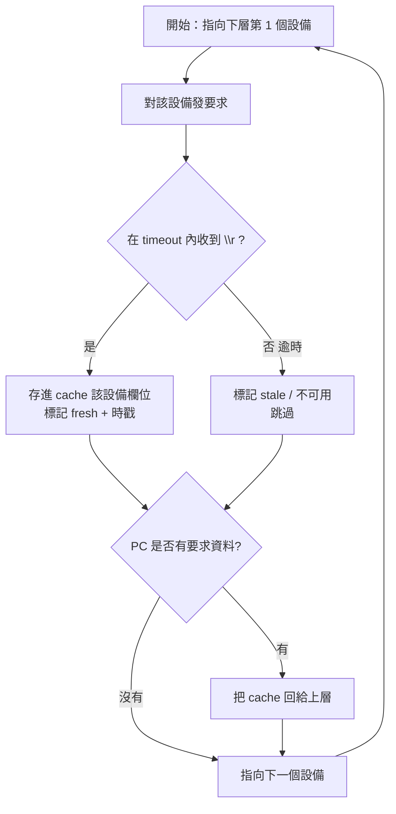

# 02 · 通訊協定

本文件是**各模組共用的契約**。建議先凍結此文件，再讓末端(Arduino)、中繼器(MicroPython)、PC(Python) 分頭實作。

## 1. 實體層

- **匯流排**：RS485 半雙工 2 線差動（A/B），multidrop，一條 bus 一個 master（該層中繼器）＋最多 64 slave。
- **中繼器 = 3 條獨立 bus / 3 顆收發器 / 3 UART**（架構定案見 [10 §1](10_自動終端與拓樸.md)）。下層依速度需求拆成兩條**彼此獨立**的 bus，不共線：

  | 埠 | 連到 | 角色 | IC 速度/邊緣 | 線長 |
  |---|---|---|---|---|
  | **UP（上層）** | 父層主幹 | slave | 高速・陡邊緣 | 短 |
  | **DOWN-trunk（下層主幹）** | 子中繼器 | master | 高速・陡邊緣 | 短 |
  | **DOWN-leaf（下層葉）** | 末端設備 | master | **低速・限斜率** | 長 |

- **收發器選型（依速度分流）**：
  - **中繼器上下骨幹（UP + DOWN-trunk）＝高速 485 IC**：中繼器↔中繼器（含↔PC）的高速轉發鏈路。
  - **中繼器↔末端（DOWN-leaf）＝低速 485 IC**：長葉段限斜率、抗 EMI／反射；與骨幹**獨立 bus**、不同速率。
  - **目前測試階段先用 MAX13487（AutoDirection，免 DE/RE GPIO，但需偏壓）過渡**；正式料號分流（高速件 vs 低速限斜率件）與「避免 AutoDirection、改手動 DE/RE」的最終定案見 [10 §6](10_自動終端與拓樸.md)。
- **Baud**：起步建議 **115200 8N1**（先求穩，之後量測後再往上調）。同一條 bus 全節點同 baud；但**骨幹 bus 與葉 bus 各自獨立設 baud**（骨幹高速、葉低速），非全樹同一 baud。
- **偏壓/終端**：每條 bus 兩端各一顆 120Ω 終端電阻；偏壓每條 bus **只放一組**（頭端），設備端一律不加。長葉段建議走 true fail-safe／可切換終端收發器免手動偏壓（見 [10 §4/§5](10_自動終端與拓樸.md)）。

## 2. 框架：byte 串流 + `\n` 未完 / `\r` 完成

資料以 **byte 為單位**串流。傳送端：

- 這段資料**還沒送完** → 該段結尾送 `\n`（0x0A）＝「還有，繼續等」。
- 整筆資料**送完了** → 結尾送 `\r`（0x0D）＝「這筆完整結束」。

接收端邏輯（**per-record emit，定版**：每遇 `\n`/`\r` 就吐出「一筆」記錄，並帶 `final` 旗標）：

```
buf = []
while True:
    b = read_byte()              # 逐 byte
    if b == '\n':                # 一筆完整、批次未完
        deliver(buf, final=False)   # 交出這一筆，後面還有
        buf = []
        continue
    if b == '\r':                # 一筆完整、批次結束
        deliver(buf, final=True)    # 交出最後一筆，這批收工
        buf = []
        return
    buf += b
```

> 白話：`\n` = 「這**一筆**完整了，但後面還有」；`\r` = 「這一筆完整了，而且整批到此為止」。
> 每一段（`\n` 或 `\r` 結尾）都是**一筆獨立記錄**——單筆回報就是一筆 `\r`；中繼器一次回一批孩子，就是多筆 `\n` + 最後一筆 `\r`（見 §3 末註）。此語意由 [共用協定庫 lib/](../lib/README.md) 的 `FrameDecoder` 保證，C++/Python 一致。

### 2.1 重要限制：payload 不能含裸 `\n` / `\r`

因為 `\n`/`\r` 被當成框架控制字元，**傳輸內容本身不可出現裸的 0x0A/0x0D**。做法：

- **JSON 一律單行（minified）**，不要 pretty-print。
- 若欄位值可能含換行，先做逃逸（`\\n`）或 base64。

（若日後 payload 必須含二進位，`\n`/`\r` 框架就不夠用，需改成「長度前綴」或 byte-stuffing——見 [06 設計決策](06_設計決策與待確認.md)。）

## 3. 傳輸內容格式（一筆完整資料）

一筆以 `\r` 收完的完整資料 = **完整分層位址 + 末端傳感器資訊**。建議格式：

```
<full-address>|<minified-json>\r
```

範例（單行）：

```
1-32-4|{"t":"TMP","v":26.7,"u":"C","ts":1723100000,"ok":1}\r
```

- `full-address`：字串路徑，如 `1-32-4`（逐跳前綴拼出，見 [03 §3](03_定址與指撥開關.md)）。
- `json`：該末端的量測 payload（型別、值、單位、時戳、狀態）。schema 見 [schema/](../schema)。

> 分段（未完 `\n`）可以用在「一台中繼器要一次回一批孩子」時：每個孩子一行以 `\n` 結尾，最後一行以 `\r` 收尾，代表這批回完。

### 3.1 編碼定案（2026-09-16）：第一 byte 判別 · MODBUS 對外 · 私有格式對內

**核心：每個 frame 的第一個 byte 就是「用哪個解析器」的判別。** 以此統一 MODBUS（對外互通）與私有格式（樹內高速）。

| 第一 byte | 意義 | 框架 | 用在 | CRC |
|---|---|---|---|---|
| **`0x01`–`0x3F`（1–63）** | 一般 MODBUS 定址（本地 slave 位址） | MODBUS RTU（3.5 字元靜默） | **末端兩側**（↔外部外設、↔中繼器） | MODBUS CRC-16（幀尾 2 byte） |
| **`0xFF`** | **MODBUS 廣播** | MODBUS RTU | 對整條 bus 全體下令 | MODBUS CRC-16 |
| **`0xFE`** | **私有格式** | `…*<crc16>\r`（**`\r` 前驗 CRC**） | **中繼器 ↔ 中繼器骨幹（含 ↔PC）**；亦可在任一 bus 承載 JSON | CRC-16/MODBUS，`*<hex>` 附於 `\r` 前 |

> `0x00` 空出（MODBUS 標準廣播已改用 `0xFF`）；`0x40`–`0xFD` 保留。

**分工（2026-09-16 定案，蓋掉先前「整棵樹走私有」）——MODBUS 在末端兩側(edge)、私有格式只在中繼器骨幹(core)**：
- **末端 ↔ 外部外設**：**末端＝MODBUS master**，MODBUS RTU 讀外部 PLC 感測/驅動模組，**bus 速率 115200**。外設**不進樹狀定址**——末端 MCU 抓值後放進本地 cache。
- **末端 ↔ 中繼器（葉上行）**：**中繼器＝MODBUS master、末端＝slave**。末端把 cache 的聚合值以 **MODBUS 暫存器**呈現給中繼器輪詢（任何標準 MODBUS master／PLC 也能在葉層接進來讀）。
- **JSON descriptor 定義「末端怎麼抓每個外設」**（regtype/addr/fc/dtype/word_order/scale 綁定，見 [08 §6/§7](08_末端外設_Driver_韌性架構.md)）。
- **中繼器 ↔ 中繼器（骨幹，含 ↔PC）**：走 `0xFE` **私有格式**、**高速 RS485**。**第一台中繼器**把末端的 MODBUS 讀值**轉成私有格式**、開始逐跳前綴 path。外設多時 cache 量大 → 骨幹要高速。

**私有格式 frame（`0xFE`，骨幹）**：
```
0xFE 1-2-3-7|25.1,3.2,1013*A3F1\r
     └ path ┘└ 值(descriptor 定順序) ┘└CRC┘
```
- path **只到末端節點**（不含外設段）；payload = descriptor 定序的值（CSV）或 JSON。
- **CRC-16/MODBUS**：**每次 `\r` 前檢查**；驗不過丟棄該筆 → 逾時 → stale。**逐跳重算**（中繼器前綴位址後用新內容重算）。實作只動協定庫（`protocol.py` + `protocol.h/.cpp` 的 `crc16()`、`CRC_ENABLED=True`，以 `test_vectors.json` 對齊）。

**JSON 只用兩處**（皆包在 `0xFE` 私有格式內）：
1. **首次連接**：node 自描述 DESC（身分 + `peripherals[]` + 每個外設的 MODBUS 抓取方式）。
2. **定期存活檢查**：每 **10 秒**一次，確認 node 仍在線（與框架外健康 envelope `ok`/`up`/`rst` 互補）。

- **`age` + 健康 envelope 放框架外** → 中繼器純轉發、不碰 payload、免 age 疊層。
- **指標式組裝**：末端按 descriptor 順序**指向各外設 cache 槽**串出 payload，免中間 JSON 物件（見 [09 §4](09_軟體架構定案.md)）。
- 詳細軟體架構定案見 [09](09_軟體架構定案.md)；MODBUS 綁定見 [08](08_末端外設_Driver_韌性架構.md)。

### 3.2 量測 payload 格式候選（CSV / 縮寫 KV）—— 2026-10-07 記

JSON 分兩用途：**① 組態 descriptor**（身分 + 外設抓法；少送、自描述）→ **永遠 JSON、不動**；
**② 量測資料**（熱路徑、每輪跑）→ **這組要瘦身**。候選（都包在 `0xFE <path>|<payload>*<crc>\r` 裡，差別只在 `<payload>`）：

| 格式 | 範例（溫/壓/高 三值）| ~byte | 可讀 | 自描述 |
|---|---|---|---|---|
| JSON（基準）| `{"t":"TMP","v":25.1,"u":"C","ok":1}` | ~40 | ◎ | ◎ |
| **CSV 值-only** | `25.1,3.2,1013` | ~13 | ○（數字可見；誰是誰要對 descriptor）| ✗ |
| **縮寫 key=val** | `t=25.1;p=3.2;a=1013` | ~19 | ◎ | ◎ |

- **CSV** = 密度冠軍（省 ~60%）；**縮寫 KV** = 自描述、好除錯（省 ~50%）。
- **轉譯只發生「一次」、在第一台中繼器**：末端對上是 **MODBUS slave（暫存器）**，**第一台中繼器讀暫存器 → 轉成文字格式（CSV/KV）一次**；之後 backbone 每一跳只「前綴 path + 重算 CRC、**不解析 payload**」=不轉譯。所以精簡格式的好處（byte 少 → 線上快）拿得到，而**轉譯成本只付一次且小**（第一台中繼器照 descriptor 把暫存器值串成字串）。
- byte 數決定線上時間，RS485 多為**頻寬受限** → backbone 用 **CSV/KV 比 JSON 端到端更快**。選 CSV 還是 KV 不影響「一次轉譯」的成本（第一台中繼器建字串兩者差不多），純看密度 vs 除錯。
- **二進位（length-prefix）**最密但不可讀、resync 難、要改框架 → **先不採用**；靠**第一 byte 判別**保留為未來旗標後路。純速度優先靠**拉 baud**（與格式正交、不犧牲可讀性/穩定性）。
- ⏳ **待定**：② 量測資料選 **CSV（重密度）** 還是 **縮寫 KV（重除錯/自描述）**。見 [06 設計決策](06_設計決策與待確認.md)。

## 4. 輪詢時序與逾時（中繼器行為）

以第 1 層中繼器為例（[需求 14、15]）：



要點：

1. **round-robin**：問完一個孩子（收到 `\r` 或逾時），就回頭看上層有沒有要，再問下一個。
2. **逾時就跳過**：等 `\r` 期間逾時 → 不卡住，標記該孩子 stale，換下一個。逾時值建議可調（依 baud 與最大 payload 估）。
3. **上層要求優先權**：上層一要，優先回 cache，不必等當前輪詢跑完一圈。

## 5. 請求 / 回應方向

- **PC → 第1層中繼器**：要資料（可「要全部 cache」或「要指定位址」）。
- **中繼器 → 下層**：主動輪詢（master）。
- **下層 → 中繼器**：被問才回（slave）。
- 中繼器對上層也是 slave：**平時不主動推**，被要求才回 cache。

## 6. 進階（編輯）模式

當設備指撥的**功能位撥到 OFF（進階/編輯）**時（見 [03 §2](03_定址與指撥開關.md)），該設備進入設定模式，接受寫入（例如燒錄/更新它的 JSON、設定參數）。常規（ON）時只做「向下讀取/回報」。編輯模式的指令集另訂（建議：`CFG|<addr>|<json>\r`），先在 [06](06_設計決策與待確認.md) 佔位。

## 7. 待確認事項（彙整於 06）

- 廣播機制。→ ✅ 已定：**節點 DIP 位址 0 保留**（樹狀定址）；**MODBUS 外設 bus 廣播＝第一 byte `0xFF`**（見 §3.1）。兩者不同層。
- 框架。→ ✅ 已定：私有格式（`0xFE`）用 `…*<crc>\r`；MODBUS（1–63/`0xFF`）用原生 RTU 靜默框架（見 §3.1）。
- 是否需要 CRC/checksum。→ ✅ **已定：CRC-16/MODBUS**；私有格式 **每次 `\r` 前檢查**（見 §3.1）。
- 上層「要指定位址」的請求語法。→ `REQ|<addr|ALL>`（位址到**節點**；外設由該節點 cache 提供）；動詞 DESC/REQ/SET 見 [09](09_軟體架構定案.md)。
- 外設定址。→ ✅ 已定：**外設不進樹狀定址**，由末端 MCU 抓取(MODBUS@115200)+cache，descriptor 定索引與抓取方式（見 [08](08_末端外設_Driver_韌性架構.md)、[06 §N](06_設計決策與待確認.md)）。
