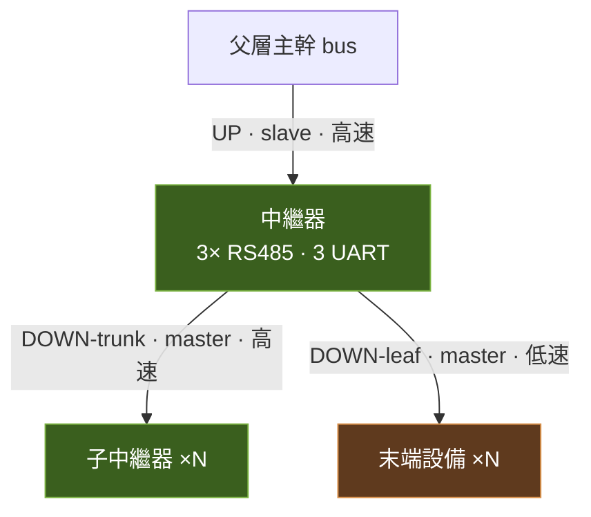
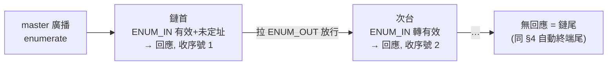

# 10 · 自動終端與拓樸（中繼器三埠定案）

> 本文定案 RS485 匯流排的**中繼器埠架構、匯流排分類、自動終端與偏壓策略、收發器選型方向**。
> 相容既有：拓樸見 [01](01_系統架構.md)、電氣黃金法則見 [known_good_baseline](known_good_baseline.md)、分段選件見 [08 §3](08_末端外設_Driver_韌性架構.md)、待辦見 [06](06_設計決策與待確認.md)。

---

## 1. 中繼器 = 3 顆 RS485 收發器

一台中繼器的下層**可能同時掛「子中繼器」與「末端設備」兩類**；兩者速度 / 邊緣 / 線長需求不同，故下層拆成兩條獨立 bus，加上一條上層，共 **3 埠 / 3 顆收發器 / 3 個 UART**。

| 埠 | 對象 | master/slave | 速度・邊緣 | 距離 |
|---|---|---|---|---|
| **上層 UP** | 父層主幹 | slave（被輪詢） | 高速・陡邊緣 | 短 |
| **下層-主幹 DOWN-trunk** | 子中繼器（可多台） | master | 高速・陡邊緣 | 短 |
| **下層-葉 DOWN-leaf** | 末端設備（可多台） | master | **低速・限斜率** | 長 |

**末端（葉）節點 = 1 顆收發器**：葉段上的 slave，接上層葉匯流排 + 同層末端。

## 2. 為什麼下層一定要拆兩條（不能靠自適應合併）

- **baud 可韌體切、slew（邊緣斜率）硬體固定**：高速全斜率收發器就算把 baud 調慢，邊緣依舊很陡 → 長葉段 EMI / 反射。長線穩健要靠**限斜率低速件**，不是降 baud 能換來的。
- **兩類設備同時存在**：多點匯流排上 baud 是**全 bus 共識**，無法同時對子中繼器（快）與末端（慢）跑不同速/邊緣。
- 故：**主幹（快・短・匯聚）**與**葉（慢・長・分散）**各一條 bus、各一顆收發器。

> 若某埠確需「同一條線又要快又要柔」，才考慮**斜率可切**收發器（TI THVD1424）；本架構因兩類分流，不需要。

## 3. 每條 bus 的終端與偏壓（各自獨立計算）

每條 bus 永遠**剛好頭尾兩顆 120Ω**：

- **頭** = 上游驅動端（中繼器該埠）→ **固定 120Ω**，結構上就是頭，免偵測。
- **尾** = 最末一台設備 → **自偵自投**（見 §4）。
- **偏壓**：每條 bus **只放一組**（擺在頭端），或改用 **true fail-safe 收發器 → 完全免偏壓（建議）**。**設備端一律不加偏壓**（每台加會拉歪 idle + N 倍耗電，見 [known_good_baseline](known_good_baseline.md)）。
- 終端耗電**與台數無關**（只有兩端）；偏壓耗電**每條 bus 固定**（單組）。唯一隨台數線性增加的是偵測電路（每台一顆 INA180 靜態電流 ~260µA）。

## 4. 尾端自動終端（自主・免位址・免上層資訊）

- 每台在**往下一台的電源線**串 `0.1Ω` shunt + **INA180** 電流感測。
- **有下游電流 → 我不是尾**；**無電流 → 我是尾 → 投 120Ω**。
- 頭端由上游固定提供，故一條 bus 恰好兩端終端。
- **需持續重評**：下游一上電就交棒（上游撤、新尾補）。
- 邊角案例：下游「有接但沒通電」會被判成無電流 → 可加**微負載/上拉**讓「有接就有涓流」，把「有接」與「有電」解耦。
- **前提**：A/B、電源、**`ENUM` 自動定址線**走**同一組 in/out 連接器、同順序**串下去（ENUM 見 §8）。

## 5. 120Ω 投切硬體（擇一）

| 方案 | 內容 | 評價 |
|---|---|---|
| **內建可切換終端收發器（首選）** | TI **THVD1454 / THVD1424**、ADI **LTC2859 / LTC2861**：晶片內含 120Ω + 開關，MCU 一支 **TERM 腳**控制 | 免外部開關、無 Ron 失配、無雙向體二極體問題 |
| PhotoMOS（備案） | 光伏+背靠背 MOS 一體（例 Panasonic **AQY212**）串外部 120Ω | 要挑 **Ron ≤ 2Ω**，否則失配反射；料多 |

> 晶片端**沒有**自動偵測末端的功能；「自動」一律靠本地 **INA180 判斷 → 驅動 TERM 腳 / PhotoMOS**。決策在本地、免位址、免上層。

## 6. 收發器選型方向（原理定案・最終料號待定）

| 埠 / 角色 | 需求 | 候選 | 免偏壓 |
|---|---|---|---|
| 上層 / 下層-主幹（快） | 手動 DE/RE、高速、fail-safe | **MAX13486E**(16M)、TI 高速 THVD、ADI LTC | ✅ |
| 下層-葉 設備端（慢長・要自動終端） | 低速 fail-safe + 可切換終端 | **THVD1454**，或 THVD2450 + PhotoMOS | ✅ |
| 各 bus 頭端固定終端 | 純電阻 120Ω | — | — |

- **避免 AutoDirection 件（MAX13487/88）** → 需外部偏壓（AutoDirection 要乾淨 idle）。一律走**手動 DE/RE**，韌體留 `MANUAL_DIR` 旗標（見 [08 §3.3](08_末端外設_Driver_韌性架構.md)）。
- fail-safe 原理：真 fail-safe 件把接收門檻往負偏移（idle 0V 讀成 high）→ 免偏壓。

## 7. MCU / UART 後果

- **中繼器 3 收發器 = 3 UART**。RP2040 硬體 UART 只有 2 → **用 PIO 補第 3 個 UART**，或中繼器改用**多 USART 的 STM32（F4 有 3+）**。
- 末端節點 1 收發器，UART 需求低。

## 8. 自動定址（ENUM 枚舉・2026-10-13 定案）

**取代手動 DIP**（DIP 全拿掉，見 [06 §O](06_設計決策與待確認.md)）。騎在 §4 的 in/out daisy-chain 上，**加一條 `ENUM` 鏈致能線**取得「同層實體順序」。

> ⚠️ **2026-11-01（EZ_IO）**：ENUM 枚舉做**探索（誰在鏈上、物理順序）+ 自動終端**；**使用者看到的「編號/身分」一律以 JSON 為主**（identity，不依物理位置），對照型錄、跟著設備走。見 [06 §O-2](06_設計決策與待確認.md)。

### 8.1 硬體

- in/out 連接器多一條 **`ENUM`**：每台 **`ENUM_IN`**（上游鄰居來）/ **`ENUM_OUT`**（給下游鄰居）。
- bus **頭端** `ENUM_IN` 由 master（中繼器該埠）固定致能（結構上就是鏈首）。
- 1 支 GPIO 讀 `ENUM_IN`、1 支 GPIO 驅 `ENUM_OUT`（或共用、開集極）。

### 8.2 枚舉流程（master 主導）

1. master 廣播 `enumerate`。
2. **只有 `ENUM_IN` 有效且未定址**者回應（鏈上當前最前的未定址台）。
3. master 配**下一個序號**（本地鏈序 1,2,3…）。
4. 該台拉 **`ENUM_OUT`** → 致能下一台 `ENUM_IN`。
5. 重複至**無回應 → 鏈尾**（與 §4「無下游電流」的尾一致）。

### 8.3 路徑 / 深度 / 熱換

- **全路徑** = 父層 path（master 自己的）+ 本地鏈序。中繼器把自己的 path 下告子節點。
- **深度**由上游枚舉鏈得知（沒有上層就沒有下層）。
- **換板**：新板上電為未定址 → master 重枚舉（或自該位置起）→ 依鏈序**復位同位址**。
- **進階/編輯模式**（原 DIP 功能位）改走**軟體指令**（位址 N → CFG），見 [03](03_定址與指撥開關.md)、[02 §6](02_通訊協定.md)。

### 8.4 邊角

- `ENUM_IN` 有效但**未通電** → 鏈斷、下游不被致能 → 沿用 §4 的**微負載/上拉**把「有接」與「有電」解耦，並讓 master 能偵測「鏈中斷點」上報。
- 位址衝突不可能發生（序號由 master 單一來源依序發）。

## 9. 待確認 / 待定料

- [ ] **下層-主幹**：multidrop（一條掛多台子中繼器）還是點對點（一條一台）？本文暫定 **multidrop**（則主幹也跑 §4 自動終端；點對點則兩端固定即可）。
- [ ] **最終料號**：THVD1454 vs THVD2450+PhotoMOS，確認 fail-safe / 速度 / 3.3V·5V / 供貨。
- [ ] **偵測細節**：INA180 增益檔、0.1Ω 功耗與壓降累積、「有接未通電」策略（微負載/上拉）。
- [ ] **中繼器 MCU**：RP2040 + PIO-UART vs STM32 多 USART。
- [ ] **ENUM 電氣**：push-pull vs 開集極+上拉；是否與既有偵測線共用腳；熱插拔時的去彈跳/重枚舉時機。

---

> 本文取代 [known_good_baseline](known_good_baseline.md) 中「手動兩端 120Ω」的做法為**自動投切**；契合 [08 §9](08_末端外設_Driver_韌性架構.md) 熱插拔 / 自主的韌性路線。
