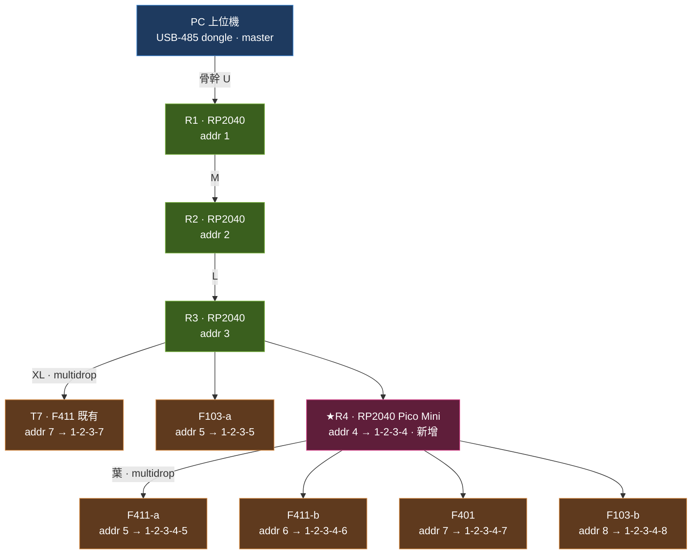

# 通訊測試 · 4 中繼器 + Pico Mini（架構驗證錨點）

> **錨點宣告**：本配置為「兩層以上樹狀 + multidrop + 第一 byte 混流 + 新中繼器 drop-in」的參考基準，與深鏈 [1-2-3-7](bringup_1237.md) 同級。佈線 / 換板 / 回歸測試以此為準。
> **前置基準**：本文延用 [bringup_1237](bringup_1237.md) 已驗通的深鏈（3×RP2040 + STM32 F411）與其全部接線慣例；本輪新增第 4 台 RP2040（**Pico Mini**）與 5 顆末端。
> 電氣規則見 [known_good_baseline](known_good_baseline.md)；協定見 [02](02_通訊協定.md)；平台/角色見 [08 §3](08_末端外設_Driver_韌性架構.md)。

---

## 1. 拓樸

**策略**：proven 深鏈（`PC→R1→R2→R3`）當骨幹不動；R3 下層 bus 由「單掛 T7」升級成 **multidrop + 混掛**，新 **Pico Mini（R4）** 掛此，再由 R4 長一條葉 bus。



ASCII：

```
PC ─USB─[USB-485]═U═ R1(1) ═M═ R2(2) ═L═ R3(3)          [proven spine·不動]
                                            │ XL bus（multidrop + 混掛）
                                            ├─ T7  F411既有 (7) → 1-2-3-7   ✔proven
                                            ├─ F103-a        (5) → 1-2-3-5
                                            └─ R4  Pico Mini (4)            ★新增
                                                 │ 葉 bus
                                                 ├─ F411-a (5) → 1-2-3-4-5
                                                 ├─ F411-b (6) → 1-2-3-4-6
                                                 ├─ F401   (7) → 1-2-3-4-7
                                                 └─ F103-b (8) → 1-2-3-4-8
```

## 2. 節點 / DIP / 位址 / 預期 path

| 節點 | 平台/MCU | 角色 | DIP 本地位址 | 掛在 | 預期完整 path |
|---|---|---|---|---|---|
| R1 | RP2040 | 中繼器 | 1 | PC 骨幹 | `1` |
| R2 | RP2040 | 中繼器 | 2 | R1 下層(M) | `1-2` |
| R3 | RP2040 | 中繼器 | 3 | R2 下層(L) | `1-2-3` |
| **R4** | **RP2040 Pico Mini** | 中繼器 ★新 | 4 | R3 下層(XL) | `1-2-3-4` |
| T7 | STM32 F411（既有良品） | 末端 | 7 | R3 下層(XL) | `1-2-3-7` |
| F103-a | STM32 F103 | 末端 | 5 | R3 下層(XL) | `1-2-3-5` |
| F411-a | STM32 F411 | 末端 | 5 | R4 葉 | `1-2-3-4-5` |
| F411-b | STM32 F411 | 末端 | 6 | R4 葉 | `1-2-3-4-6` |
| F401 | STM32 F401 | 末端 | 7 | R4 葉 | `1-2-3-4-7` |
| F103-b | STM32 F103 | 末端 | 8 | R4 葉 | `1-2-3-4-8` |

- 位址 1–63，`0` 保留（廣播/未配置）；功能位 **ON=常規**（[03](03_定址與指撥開關.md)）。
- **刻意的位址碰撞驗證**：DIP `5`＝`1-2-3-5`(F103) vs `1-2-3-4-5`(F411)；DIP `7`＝`1-2-3-7`(F411) vs `1-2-3-4-7`(F401)。→ 上層須靠完整 path 區分，不因本地位址同而混。

## 3. 收發器 / 供電

- **PC 端**：USB-485 dongle（外部，不佔 13487；多半自帶偏壓 + 可切終端）。
- **13487 用量**：R1/R2/R3/R4 各 2（up+down）= 8 + 末端 6 = **14 顆 MAX13487**（庫存 20 足）。
- **THVD1426（手動 DE/RE）本輪不混入**——proven 鏈全 13487 AutoDir，保持已知良品；`MANUAL_DIR` 另開獨立實驗。
- 每顆 13487：`VCC→5V(VBUS)`、`GND 共地`、`/RE→GND`（常收）、`/SHDN→5V`。
- STM32 末端需插 **USB-C(VBUS 5V)** 才餵得動收發器。

## 4. 偏壓 / 終端配置（13487 AutoDir 必須有乾淨 idle）

> **黃金法則**：每條 bus = **2×120Ω 終端（物理兩端）+ 1 組偏壓（2×560Ω，全 bus 一處）**。
> **偏壓是「每條 bus 一組」，不是「每顆節點一組」**（每節點加 → 拉歪 idle + N 倍耗電）。

| # | Bus 段 | 節點 | 終端 120Ω | 偏壓 2×560Ω | 偏壓放哪顆板 |
|---|---|---|---|---|---|
| 1 | 骨幹 U | USB-485 ↔ R1.up | 2（dongle端＋R1端）| **免**（dongle 自帶）| — |
| 2 | M | R1.down ↔ R2.up | 2 | 1 組 | R1（down 側）|
| 3 | L | R2.down ↔ R3.up | 2 | 1 組 | R2（down 側）|
| 4 | XL（multidrop）| R3.down · T7 · F103-a · R4.up | 2（物理兩端）| 1 組 | R3（down 側）|
| 5 | 葉（leaf）| R4.down · F411-a/b · F401 · F103-b | 2（物理兩端）| 1 組 | R4（down 側）|

**一句話規則**：**只有「下行 master 側」的板放偏壓**（R1/R2/R3/R4 各一組）；**末端板一律不放偏壓**，僅當它落在 multidrop 的物理端點時才放一顆 120Ω 終端。

**電阻 BOM（本次）**：

| 值 | 數量 | 用途 |
|---|---|---|
| 120Ω | 10 顆（每 bus 2；dongle 自帶終端則 8 外加）| 終端，跨 A-B，物理兩端 |
| 560Ω | 8 顆（4 組 × 2）| 偏壓，A→5V / B→GND，每 bus 一處 |

> 560Ω 配 2×120Ω 終端 → idle 差壓 ≈ 254mV > fail-safe 門檻 200mV。**別換值**。
> 正式版改 true fail-safe 件（MAX13485E / THVD2450 / SN65HVD75）→ 免外加偏壓，這 8 顆 560Ω 不用再吃（[08 §3.2](08_末端外設_Driver_韌性架構.md)、[10 §6](10_自動終端與拓樸.md)）。

## 5. 接線慣例（延用 [bringup_1237](bringup_1237.md)）

- **串接口訣**：一台的 `down` 接下一台的 `up`（`A↔A`、`B↔B`、`GND↔GND`）。USB-485 模組因標示相反，A/B 對調。
- **RP2040 UART**（R1–R4 皆同）：`up=UART1（GP4→DI, GP5←RO 分壓）`、`down=UART0（GP0→DI, GP1←RO 分壓）`；避開 W5500 的 GP16–21。
- **STM32 末端 UART**：`up=USART1（PA9→DI, PA10←RO 直接·FT 腳）`。
- **準位（RO→MCU RX）**：RP2040 經 `1.8k/3.3k` 分壓（5V→3.24V）；STM32 FT 腳直接。`TX→DI` 一律直接。

### 5.1 Pico Mini 專屬注意（新板）

- **先確認 `GP0/GP1/GP4/GP5` 有拉出且未被板載外設佔用**（RP2040-Zero 類有；Tiny2040 類腳位較少需查）→ 沿用上表 UART 慣例才免改韌體。
- 確認 Pico Mini 有可用 **5V(VBUS)** 供 13487 `VCC`；若僅出 3.3V，改 3.3V fail-safe 件或另拉 5V。

## 6. 分階段 Bring-up 測試清單

> 原則：**新板（R4 Pico Mini）當唯一變數**，先回歸 proven 段，再孤立新板，最後展開。每階段起步可先降 **38400** 買 settle 餘裕，穩了再回 115200。

### Phase 0 · proven 回歸（R3 bus 變 multidrop）
- [ ] R3 下層先只接 T7 + F103-a（**不接 R4**），兩端 120Ω + R3 一組偏壓。
- [ ] PC 看到 `1-2-3-7`（T7）、`1-2-3-5`（F103-a）皆 fresh。
- [ ] 確認把 T7 從 point-to-point 變 multidrop 後，`1-2-3-7` 仍穩（無反射/亂碼）。

### Phase 1 · 孤立新板 R4（Pico Mini）
- [ ] XL bus 加掛 R4（addr 4），R4 up 接 R3 下層 bus。
- [ ] R4 首次連接送 **DESC**（`0xFE` 私有 frame）→ PC 看到 `1-2-3-4` 節點上線。
- [ ] 確認 XL bus 上 **MODBUS（↔T7/F103-a）與 `0xFE`（↔R4）第一 byte 混流**正常，彼此不干擾。
- [ ] R4 葉 bus 先空載，確認 R4 自身 up/down UART、供電、偏壓（R4 down 側 1 組）就緒。

### Phase 2 · 展開 R4 葉 bus
- [ ] 逐顆加：F411-a(5)、F411-b(6)、F401(7)、F103-b(8)，葉 bus 兩端 120Ω。
- [ ] PC 看到 `1-2-3-4-5 / -6 / -7 / -8` 皆 fresh。
- [ ] 驗 **depth 5 聚合**：path 逐跳前綴 `8 → 4-8 → 3-4-8 → 2-3-4-8 → 1-2-3-4-8` 正確。
- [ ] 驗 **CRC-16/MODBUS 逐跳重算**（`\r` 前驗）：全鏈無 CRC 丟棄（[02 §3.1](02_通訊協定.md)）。
- [ ] 驗 **位址碰撞不混**：`1-2-3-5`(F103) vs `1-2-3-4-5`(F411)、`1-2-3-7` vs `1-2-3-4-7` 各自獨立。

### Phase 3 · 韌性 / 效能
- [ ] **blast radius**：拔 R4 → 只 `1-2-3-4-*` 轉 stale、`1-2-3-7`/`1-2-3-5` 存活；拔 R3 → 整個 `1-2-3-*` 全黑、其餘不受影響（[08 §9](08_末端外設_Driver_韌性架構.md)）。
- [ ] **逾時跳過**：拔單顆末端 → 該 path stale、輪詢不卡（[02 §4](02_通訊協定.md)）。
- [ ] （選配）**rate-bridge**：骨幹升 460800（13487 上限 500k 內）、葉維持 115200 → 驗 `up_baud≠down_baud`（[08 §10](08_末端外設_Driver_韌性架構.md)）。
- [ ] （已知 cosmetic）觀察 **age 疊層**：depth 5 多跳 JSON 可能多次 `age`，功能無礙（[08 §13](08_末端外設_Driver_韌性架構.md)）。

## 7. 覆蓋機制對照

| 機制 | 本錨點怎麼驗 | 階段 |
|---|---|---|
| proven 深鏈回歸 | `1-2-3-7` 在 multidrop 下仍成立 | P0 |
| 新中繼器 drop-in | `1-2-3-4` DESC 上線 | P1 |
| multidrop | XL（3 子）、葉（4 子） | P1–P2 |
| 第一 byte 混流 | XL 同線 MODBUS + `0xFE` | P1 |
| 逐跳前綴 · depth 5 | `1-2-3-4-x` | P2 |
| CRC 逐跳重算 | 全鏈 `\r` 前驗 | P2 |
| 位址碰撞區分 | DIP 5/7 跨分支 | P2 |
| 混款 MCU | M4F(F411/F401) + M3(F103) | P2 |
| blast radius / 逾時 | 拔 R4 / R3 / 單末端 | P3 |
| rate-bridge | 骨幹 460800 / 葉 115200 | P3 |

## 8. 待填（實測後回填）
- [ ] 各 bus 實測 baud / 誤碼率 / settle 時間。
- [ ] Pico Mini 實際 GP 腳位與供電結論。
- [ ] rate-bridge 上限（骨幹能穩定跑到多少）。
- [ ] 對照圖（仿 [hardware_1237.svg](hardware_1237.svg)）補一張 4rep 版。
